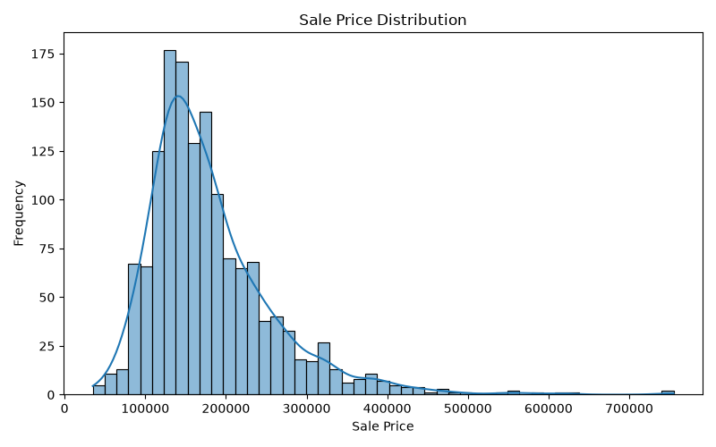
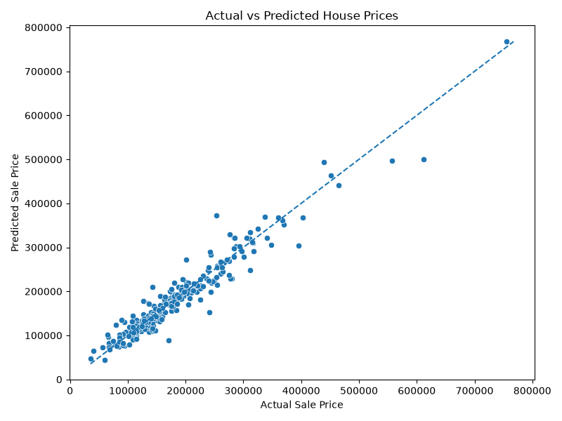

# House Price Prediction

A Machine Learning project that predicts residential house prices using the **House Prices - Advanced Regression Techniques** dataset from Kaggle.

## Project Overview

This project uses Linear Regression to predict house sale prices based on various property features.

The workflow includes data preprocessing, handling missing values, encoding categorical variables, feature scaling, model training, and evaluation.

## Dataset

The dataset is provided by Kaggle:

[House Prices - Advanced Regression Techniques](https://www.kaggle.com/competitions/house-prices-advanced-regression-techniques/data)

Download the following files and place them inside the `data/` directory:

- `train.csv`
- `test.csv`

## Technologies Used

- Python
- NumPy
- Pandas
- Matplotlib
- Seaborn
- Scikit-learn

## Machine Learning Workflow

1. Data loading and exploration
2. Numerical and categorical feature identification
3. Missing value imputation
4. Feature scaling using StandardScaler
5. Categorical encoding using OneHotEncoder
6. Data splitting (80% training, 20% testing)
7. Model training using Linear Regression
8. Model evaluation

## Model

**Linear Regression**

A Scikit-learn Pipeline and ColumnTransformer are used to combine preprocessing and model training.

The target variable is log-transformed using `log1p()` during training, and predictions are converted back using `expm1()`.

## Model Evaluation

Results on the 20% test split:

| Metric | Result |
|---|---:|
| RMSE (Log Scale) | 0.1321 |
| RMSE | 22,906.83 |
| R² Score | 0.9316 |

## Visualizations

### Sale Price Distribution



### Actual vs Predicted Prices



## Project Structure

```text
House-Price-Prediction/
│
├── data/
│   ├── train.csv
│   └── test.csv
│
├── images/
│   ├── saleprice_distribution.png
│   └── actual_vs_predicted.png
│
├── src/
│   └── house_price.py
│
├── README.md
├── requirements.txt
└── .gitignore
```

## Installation

Clone the repository:

```bash
git clone https://github.com/YOUR-USERNAME/House-Price-Prediction.git
```

Navigate to the project directory:

```bash
cd House-Price-Prediction
```

Install dependencies:

```bash
pip install -r requirements.txt
```

Download the Kaggle dataset and place `train.csv` and `test.csv` inside the `data/` directory.

## Run the Project

```bash
python src/house_price.py
```

The model will train, evaluate its performance, generate visualizations, and save predictions in `predictions.csv`.

## Author

**Your Name**